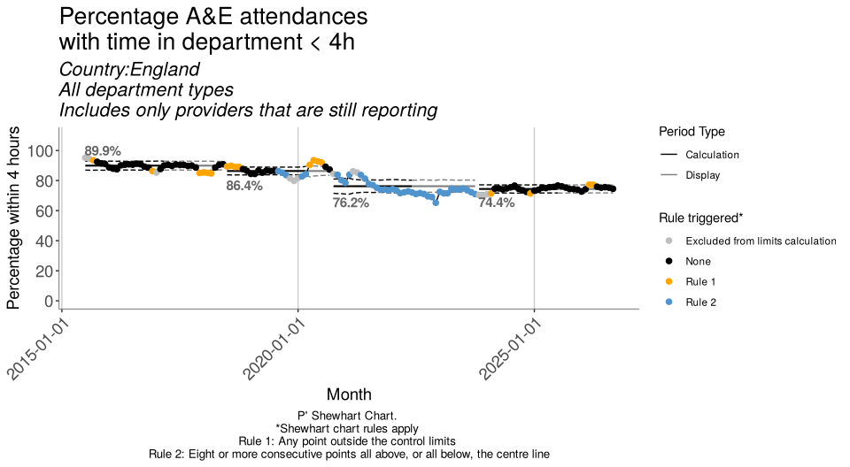
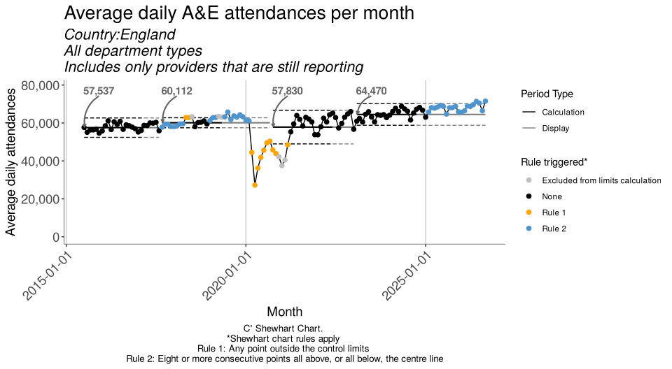

<!-- README.md is generated from README.Rmd. Please edit that file -->

# AE-app

The goal of AE-app is to provide interactive analysis of time series
data on accident and emergency department attendances. A live instance
of the app can be found [here](https://clahrcnwl.shinyapps.io/ae-app/).

The app currently provides analysis of the monthly number of
attendances, and the percentage of attendances where the patient was
admitted, transferred or discharged within four hours of arrival. The
app performs this analysis for publicly available [NHS
England](https://www.england.nhs.uk/statistics/statistical-work-areas/ae-waiting-times-and-activity/)
and [NHS
Scotland](http://www.isdscotland.org/Health-Topics/Emergency-Care/Publications/data-tables2017.asp?id)
data.

More details on the methods used can be found in the “Understanding the
analysis” tab of the app.

## Data

The app reads its data from the [AE-data](https://github.com/HorridTom/AE-data)
repository, where a scheduled GitHub Action updates it every week using
[nhsAEscraper](https://github.com/HorridTom/nhsAEscraper). (Until 2025 the data
was held in a MySQL database on AWS.) The app reads the data once, when it
starts, so a running copy picks up new data when it next restarts.

## Run the app locally

You will need to install the following packages:

``` r
install.packages(c("shiny", "shinydashboard", "shinyjs", "tidyverse", "scales",
                   "zoo", "lubridate", "wktmo", "testthat", "remotes"))
remotes::install_github("HorridTom/autospc")
```

After cloning this repo, run the app as usual with:

``` r
shiny::runApp()
```

This needs an internet connection to download the data. To use a local copy of
the AE-data repository instead:

``` r
Sys.setenv(AE_DATA_SOURCE = "~/Rprojects/AE-data/data")
shiny::runApp()
```

## Tests

``` r
testthat::test_dir("tests")
```

The test data in `tests/test-data` is made by `tests/make_test_data.R`.

## Deploy

The app is hosted on [shinyapps.io](https://www.shinyapps.io/) (account
`clahrcnwl`). With the account connected in RStudio
(`rsconnect::setAccountInfo()`), deploy with:

``` r
rsconnect::deployApp(appName = "ae-app", account = "clahrcnwl")
```

autospc must be installed from GitHub (as above), so that shinyapps.io can
install the same version.

## Example analyses

Example control chart analyses are shown below for the whole of England.

<!-- --><!-- -->
